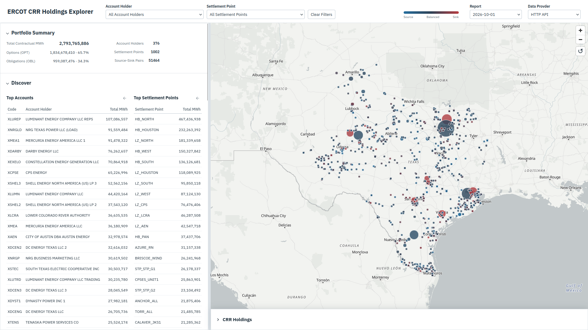
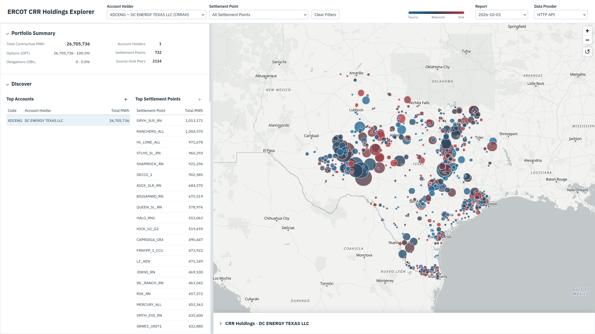
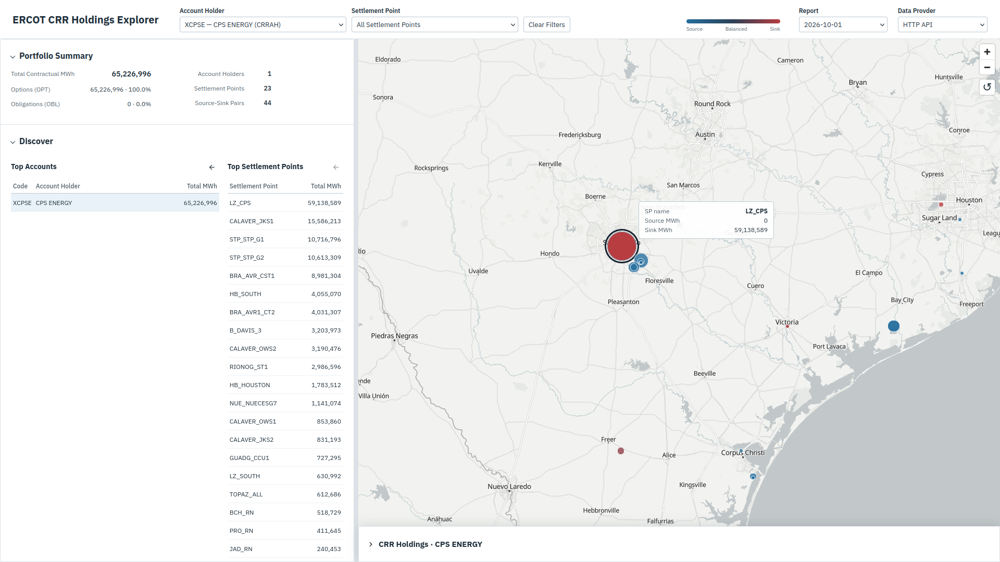

# CRR Holdings Explorer



CRR Holdings Explorer builds a SQLite database from ERCOT's `NP7-157-SG`
dataset. A FastAPI backend and web frontend let users visualize and map
source-sink holdings, filtering by account holder and settlement point - even
drilling down to see individual contracts.

The app also experiments with an in-browser SQLite database; using a full
database download and WASM runtime, and an (attempt) at HTTP-VFS range requests.
A live toggle to switch between data providers is available on the upper right.
Warning, for some endpoints, VFS will just endlessly fetch pages and time out.

Python service code and SQL are automatically transpiled into JavaScript on
startup using [Transcrypt](https://www.transcrypt.org/), which worked
surprisingly well.

While in-browser WASM had minor performance benefits, it does not seem to
justify a large database download. Unfortunately, large HTTP-VFS queries
frequently time out, and indicate an analytical workload is likely not suitable
for that architecture. A rough `benchmark.html` page, run locally, was used to
time and track download totals, with configurable API latency.

## Quickstart

Prerequisite: ports 8000 and 5173 must be available.

1. Install Docker with Docker Compose and start Docker.
2. Clone this repository.
3. Prepare the database (skip if `db/crr/crr.sqlite` already exists):

   The database build step is defined in [db/crr/Dockerfile](db/crr/Dockerfile),
   which runs `prepare_dataset.py` to create `crr.sqlite`.

   ```sh
   docker build -t crr-dataset db/crr
   docker run --rm --user "$(id -u):$(id -g)" \
     --mount type=bind,src="$(pwd)/data",dst=/data,readonly \
     --mount type=bind,src="$(pwd)/db/crr",dst=/output \
     crr-dataset --data-dir /data --output /output/crr.sqlite
   ```

4. Build and start the app:

   ```sh
   docker compose build
   docker compose up --remove-orphans
   ```

5. Wait for Vite to report ready, then open http://localhost:5173.
6. Stop with Ctrl+C, then remove the containers:
```sh
docker compose down
 ```

7. Trouble: In the event you might need to manually generate the JavaScript from
   Python:

```sh
   # Transcrypt generation code on run
   scripts/generate-browser-services.sh
```


## Domain Analysis

This project provides an exploratory interface for questions about ERCOT CRR
holdings:

* Who / what entities participate in ERCOT CRR auctions?
* Where and what term are their hedges, and in what size?
* Do they hold similar positions, overlap, where do they differ?
* Do their portfolio profiles suggest certain operations (hedging, speculation),
  does it change direction at different times (TOU)

The Explorer offers two means of investigation:

* A visual map providing a geographic starting point.

* A holdings panel to track source-sink paths, monthly holdings, and individual
  contracts.


### Example: Utilities

A bird's eye view of the market shows most MWh are placed on hubs and loading
zones. It is common to see a generation node as a source, and a loading zone as
a sink. Utilities in particular often hedge in that pattern, for example:

* CPS Energy in San Antonio: has a large aggregate source position on power
  plants (`CALAVER_JKS1`, `STP_STP_G1`, `STP_STP_G2`), paired entirely with a
  sink on `LZ_CPS`.

* Austin Energy has a similar profile; a large sink on their local loading zone
  `LZ_AEN`, and source holdings on `FPPYD_FPP_G1`, `DECKER_GT`, and
  `STP_STP_G1`.

They share an interesting connection through the South Texas Project: both
utilities hold CRRs from `STP_STP_G1` / `STP_STP_G2` to their load zones. A
coastal nuclear plant is initially a surprising source for central Texas
utilities, but both actually share ownership of the plant. Their CRR holdings
provide a starting point to examine how generation and load interests appear in
a utility's financial positions.

This is in contrast to a number of funds and financial firms who take smaller
positions, but across a large swath of the grid: Perast has 2799 distinct
source-sink pairs, ALTOP Energy Trading has 2684 pairs, DC ENERGY, 2134;
choosing different instruments - obligations or options - and often distributing
it across different TOU (Time Of Use).

The broad, dispersed participation of funds contrasts with large, integrated
players like NRG, who has one of the largest portfolios, concentrated almost
entirely between `HUB` / `LZ` source, sink pairs. While relatively few
locations, they figure prominently in terms of gross MWh, and carry almost the
opposite profile of a smaller fund.

The map is a compelling visualization, which along with the CRR Holding panel
drop down, allows one to see the different risk profiles and detailed holdings
of each firm.




*DC Energy*

<br>



*CPS*

<br>

## Database Optimization

The initial version scanned monthly holdings to calculate summaries and
rankings. The "Top Accounts", and "Top Settlement Points" market summary took
almost 10 seconds to load, making basic exploration slow.

The biggest improvements came from:

* Pre-computing holdings totals for summary queries
* Re-using filtered results
* Adding indexes for timeline and date lookups.

Running `ANALYZE` to generate statistics helped the engine choose more efficient
ways to access the data, which interestingly, one of which was to not use an
index.

A combination of changes brought the `/summary` endpoint down to ~0.93 seconds,
source queries from ~2.2 seconds to 0.19–0.23 seconds, and sink queries from 2.4
seconds to 18 milliseconds. The [query performance
plan](docs/plan/0013-query-performance.md) provides a walk-through.

## Database API vs. WASM vs. HTTP-VFS Experiment Micro-benchmark

I also wanted to explore whether running SQLite in the browser could make the
app faster, or reduce requests to possibly make it cost-effective?

I compared three approaches:

* The existing HTTP API
* Downloading the full database and querying it in-browser with SQLite WASM
* Fetching database pages on demand through HTTP-VFS.

Transcrypt transpiled generated JavaScript directly from python code so the
browser could reuse the Python service logic and SQL.

A very rough, local `benchmark.html` page compared requests covering summaries,
rankings, pagination, and contract details. Requests used compressed content via
gzip and added 50, 100, or 150 milliseconds of network latency. Cold startup
requests were recorded separately from repeated queries, and responses were
checked against the HTTP API.

| Added API latency | HTTP average warm call | WASM average warm call |     Diff | WASM Download | Calculation                 |
|-------------------|-----------------------:|-----------------------:|---------:|--------------:|-----------------------------|
| 50 ms             |               169.3 ms |               123.1 ms |  46.2 ms |       ~17.3 s | 17.3s / 46.2ms = 375 calls  |
| 100 ms            |               191.2 ms |               101.8 ms |  89.4 ms |       ~17.1 s | 17.1s / 101.8ms = 168 calls |
| 150 ms            |               250.8 ms |               105.3 ms | 145.5 ms |       ~17.4 s | 17.4s / 145.5ms = 120 calls |


HTTP and WASM returned similar results; once loaded, WASM was slightly faster
and needed no further database downloads or requests. The cost was in the
initial download, ~85 MB compressed, expanding to 399 MB, with roughly 16.5
seconds spent downloading.

Based on these measurements, recovering that startup time cost would take
roughly 120–375 calls, depending on network latency, and matching the download
volume would take the size of about 14,100 requests (average 6kb request.)

HTTP-VFS timed out on all five services at every tested latency, completing no
workloads. While fetching only needed database pages was appealing, it did not
work well for large summations or groupings - general analytical data queries.

For an app with this type of access pattern and usage, an HTTP API offers the
practical balance of startup time, download size, and query speed. The
[benchmark plan](docs/plan/0018-benchmarking.md) contains the full setup and
results.


---

Thanks!
